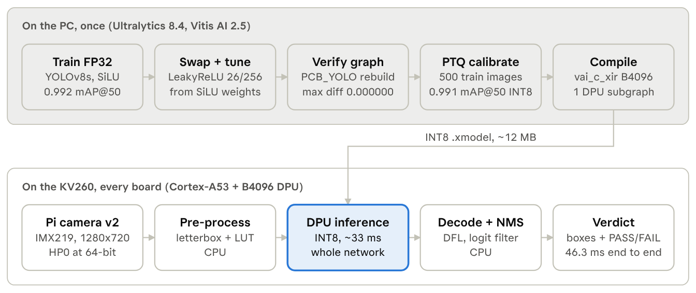
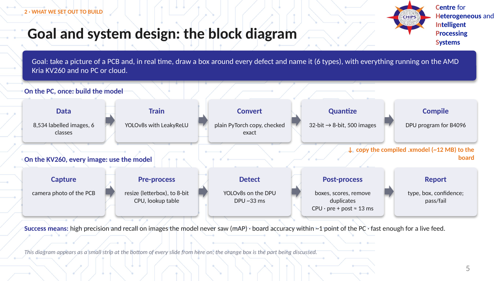
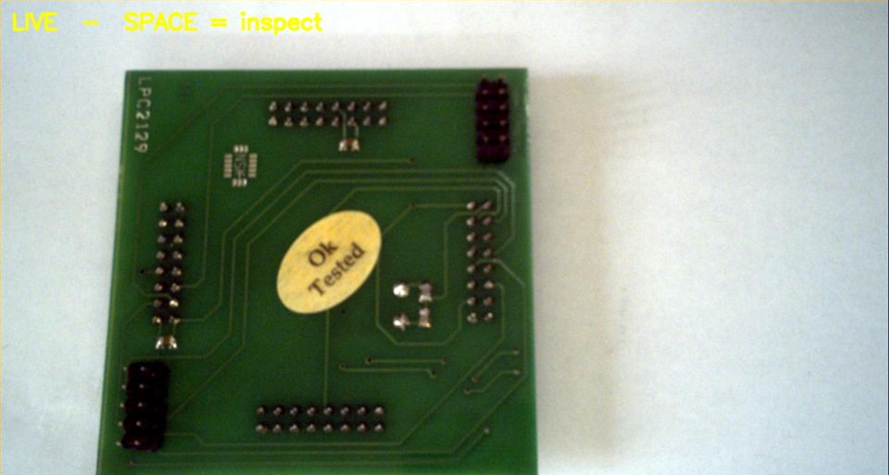
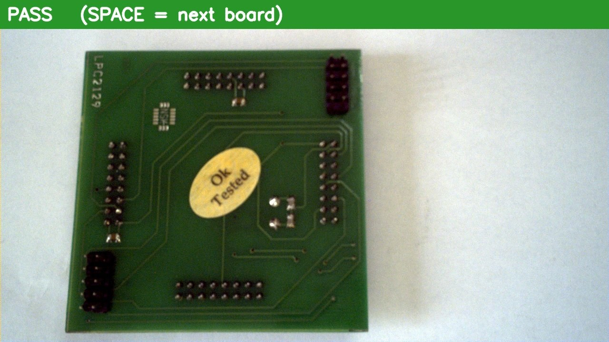

# PCB Defect Detection on AMD Kria KV260

Bharat AI SoC Challenge 2026-27 -- Problem Statement 5: Real-time edge-based industrial defect detection and quality-control assistant.

An operator places a bare PCB under a Raspberry Pi Camera v2 mounted on the KV260 and presses SPACE in a browser. A YOLOv8s model quantized to INT8 runs on the KV260's DPU, draws bounding boxes around each defect, classifies the defect type, and assigns a board-level severity. The system gives a PASS or FAIL verdict with a short recommendation and logs everything to a CSV. The whole pipeline runs on the board itself. The laptop just needs an Ethernet cable, no internet required.

[Demo video (Google Drive)](https://drive.google.com/file/d/1up3-ehCEczpyUgCcYgTC5mcAF4UC49pM/view?usp=sharing) -- also in `demo/`

Technical report: `docs/technical_report.pdf` | Presentation: `docs/presentation/` | Dataset notes: `docs/dataset/README.md`





---

## Team

| Name | SRN | Email |
| --- | --- | --- |
| Karen Mary | PES2UG23EC066 | kmary5786@gmail.com |
| Prajwal Kumar | PES2UG23EC108 | prajwalkumar3113@gmail.com |
| Shamanth P Vashishta | PES2UG23EC142 | shamanthpvasishta0105@gmail.com |

**Mentor:** Prof. Mahesh Awati (mahesha@pes.edu)

**Institution:** PES University, Bengaluru

---

## Hardware setup

| Component | Details |
| --- | --- |
| Edge platform | AMD Kria KV260 Vision AI Starter Kit |
| Camera | Raspberry Pi Camera v2 (IMX219), connected via MIPI CSI-2 on the KV260 |
| FPGA design | AMD `kv260-smartcam-raspi` (CSI-2 capture, ISP, scaler, frame buffer) |
| DPU | DPUCZDX8G B4096, provided by Kria-PYNQ 3.0 |
| OS on board | Kria Ubuntu 22.04 with Kria-PYNQ 3.0 and Vitis AI 2.5 runtime |
| Training GPU | NVIDIA RTX 4500 Ada (PC side only) |
| Connection | Direct Ethernet cable between KV260 and laptop, no router or internet needed |

## Algorithm and model

- **Model:** YOLOv8s (small variant), 640x640 input, 6 defect classes.
- **Activation swap:** The Xilinx DPU does not support SiLU. We replaced all SiLU activations with LeakyReLU at the DPU's fixed slope of 26/256 and fine-tuned from the SiLU-trained weights. This keeps accuracy while letting the entire network run on the DPU as a single subgraph with no CPU fallback.
- **Quantization:** INT8 post-training quantization via Vitis AI 2.5, calibrated on 500 training images with the same letterbox preprocessing used on the board.
- **Post-processing:** DFL-based bounding box decode and NMS, all on the ARM CPU.
- **Severity grading:** Rule-based mapping -- short and open circuit are critical, missing hole and spurious copper are major, spur and mouse bite are minor. The worst defect sets the board verdict.
- **Dataset:** PKU-Market-PCB (augmented YOLO release). 8,534 train / 1,066 val / 1,068 test images, 6 classes. See `docs/dataset/README.md`.
- **Training framework:** Ultralytics 8.4, PyTorch.

## Advisory LLM

We use an LLM on the board to give the operator a short, context-aware recommendation after each inspection.

| | Details |
| --- | --- |
| **Which** | Meta Llama 3.2 1B Instruct (SpinQuant, 4-bit) |
| **Why** | Small enough to fit and run on the KV260's quad Cortex-A53 cores. It is open-weight and instruction-tuned, so it can produce useful single-paragraph advice without needing internet or a server. |
| **How** | Exported to a `.pte` file using ExecuTorch with the XNNPACK backend. The station calls the `llama_main` runner as a subprocess, passing a structured prompt with the defect list and severity. |
| **When** | After each inspection. The rule-based advice shows instantly. If Llama is configured, it runs in the background on the ARM cores (while the DPU stays free) and its answer replaces the rule text once ready. If Llama is not set up, the system falls back to rules only. |

The prompts, integration code, and export steps are in `advisory_llm/`.

A rule-based fallback always runs first, so the operator is never waiting. The LLM path is optional and adds richer context when available.

## AI tools used during development

- **Claude and ChatGPT** were used as learning and guidance tools during development -- for understanding DPU constraints, debugging FPGA register issues, and general reference. No code was directly copy-pasted without review; they were used the way you would use documentation or a teaching assistant.
- **Llama 3.2 1B** runs on the board as described above and is part of the final system.

---

## Results

| | FP32 (PC) | INT8 (KV260 DPU) |
| --- | --- | --- |
| mAP50 | 0.992 | 0.991 |
| mAP50-95 | 0.748 | 0.734 |

- 6 classes: mouse bite, spur, missing hole, short, open circuit, spurious copper
- Validation split: 1,066 images, 2,164 defects
- DPU inference: ~33 ms; full detection pipeline: 46.3 ms (21.6 FPS)
- Entire network runs on the DPU as one subgraph, no CPU/DPU splits

Per-class accuracy, activation comparison, and speed breakdown are in `docs/results/README.md`.

| Live view | Good board (PASS) | Defect sheet (FAIL) |
| --- | --- | --- |
|  |  |  |

---

## How it works

1. **Training (PC).** YOLOv8s trained on PKU-Market-PCB with SiLU, then fine-tuned after swapping to LeakyReLU(26/256).
2. **Rebuild and verify.** Model rebuilt in plain PyTorch for Vitis AI tracing. Layer-by-layer check against Ultralytics confirms zero divergence.
3. **Quantize and compile.** INT8 PTQ with 500 calibration images, compiled for DPUCZDX8G B4096.
4. **On the board.** Camera runs through the FPGA capture pipeline. Operator presses SPACE, frame is saved, FPGA switches to DPU overlay, detection runs, severity and advice are computed, result is logged, then the camera overlay comes back.
5. **Advisory.** Rule-based advice shows instantly. Llama replaces it in the background when configured.

## Repository layout

```
training/        dataset prep, training scripts, evaluation
model/export/    PyTorch rebuild, verification, quantization, compile
model/kv260/     compiled .xmodel for the B4096 DPU
kv260_app/       inspection station (camera + DPU + web UI), detector, severity, logger
advisory_llm/    Llama advisory module, prompts, ExecuTorch export guide
scripts/         board setup, systemd services, direct-link networking
tests/           offline tests for post-processing, severity, logging
docs/            technical report, presentation, figures, dataset notes, results
demo/            demo video and screenshots
```

Each folder has its own README.

## Running on the KV260

Needs Kria-PYNQ (provides `pynq_dpu` and `dpu.bit`) and the `kv260-smartcam-raspi` design in `/lib/firmware/xilinx/`.

```bash
git clone https://github.com/prajwalachari/KV260-PS5-Embedded.git
cd KV260-PS5-Embedded
sudo bash scripts/setup.sh
```

After setup, the station starts on every boot. Connect a laptop to the board's Ethernet port and open `http://192.168.50.1:8080`. Place a board, press SPACE, read the result, press SPACE again for the next board. Results and `inspections.csv` are saved in `/home/ubuntu/inspections`.

To run detection on image files without the camera:

```bash
sudo -i
source /etc/profile.d/pynq_venv.sh
python3 kv260_app/detect.py some_board.jpg
```

## Rebuilding the model

```bash
cd training
python3 dataset_prep.py ../pcb_dataset
python3 train.py base
python3 train.py leaky
python3 eval.py runs/detect/leaky_ft/weights/best.pt val
```

Then follow `model/README.md` to verify the rebuild, quantize, and compile inside the Vitis AI 2.5 Docker.

Tests that run without the board:

```bash
pip install numpy opencv-python torch pytest
python3 -m pytest tests
```

## Engineering notes

- **Striped camera frames.** The HP0 memory port was set to 128 bits but the camera design writes 64 bits. `camera_setup.sh` fixes this.
- **Camera DPU gave garbage.** The camera design's B3136 DPU produced wrong outputs with our model, so the station swaps to the B4096 DPU overlay for each inspection.
- **Camera stalled after DPU run.** PYNQ changes some PS AXI settings when loading the DPU. `ps_regs.py` saves them at boot and restores them afterward.

## Limitations

- Training data is 10 template boards with digitally added defects. On our own boards (different copper pour, solder-mask colour), detection is weaker. Fine-tuning on labelled photos from our camera is the next step.
- Each inspection takes about 15 seconds because the FPGA switches between camera and DPU overlays. A unified design with both would remove this delay.
- Llama latency and board power draw are not yet measured.
