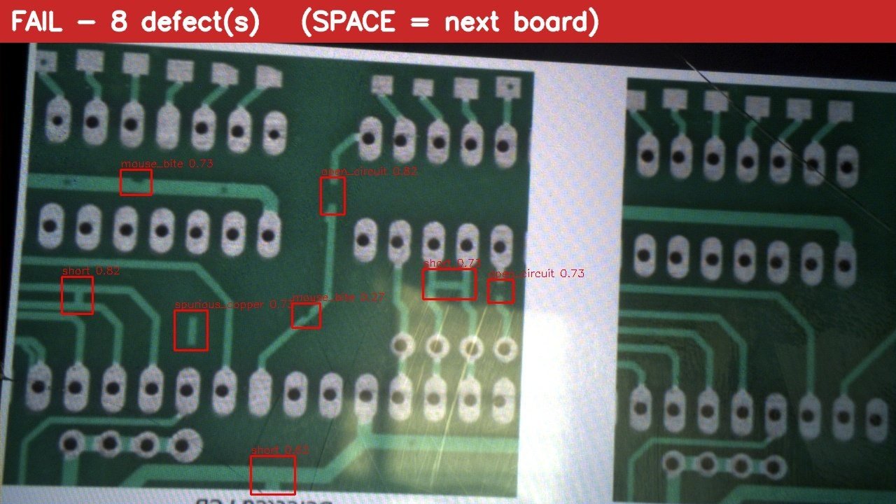

# PCB Defect Detection on the AMD Kria KV260

Bharat AI SoC Challenge 2026-27, Problem Statement 5: real-time industrial defect detection and quality-control assistant.

A bare PCB goes under a Raspberry Pi Camera v2 and the operator presses SPACE in a browser. A YOLOv8s model runs in INT8 on the KV260's DPU, marks each defect with a box and its type, and grades the board's severity. It gives a PASS or FAIL with a short recommendation and logs the result. Everything runs on the board, and the laptop only needs an Ethernet cable, no internet.

Demo video: VIDEO_LINK_HERE (see `demo/DEMO.md`)
Technical report: `docs/technical_report.pdf` · Presentation: `docs/presentation/` · Dataset: `docs/dataset/README.md`


## Results

| | FP32 (PC) | INT8 (KV260 DPU) |
| --- | --- | --- |
| mAP50 | 0.992 | 0.991 |
| mAP50-95 | 0.748 | 0.734 |

- 6 classes: mouse bite, spur, missing hole, short, open circuit, spurious copper
- Validation split of PKU-Market-PCB (augmented YOLO release, see `docs/dataset/README.md`): 1,066 images, 2,164 defects
- DPU time about 33 ms; full detection 46.3 ms (21.6 FPS)
- The whole network runs on the DPU as a single subgraph

Per-class numbers, the activation comparison and speed details are in `docs/results/README.md`.

| Live view | Good board | Defect sheet |
| --- | --- | --- |
|  |  |  |

## How it works

1. **Training (PC).** YOLOv8s is trained on PKU-Market-PCB. The DPU cannot run SiLU, so we replace it with LeakyReLU at the DPU's fixed slope of 26/256 and fine-tune from the SiLU weights.
2. **Conversion.** The model is rebuilt in plain PyTorch so Vitis AI 2.5 can trace it. We check the rebuild layer by layer against Ultralytics (max difference 0.000000).
3. **Quantization and compile.** INT8 post-training quantization uses 500 training images with the same letterbox pre-processing as the board. The model is then compiled for DPUCZDX8G B4096.
4. **On the board.** The camera runs through an FPGA capture pipeline (CSI-2, ISP, scaler, frame buffer). On SPACE the frame is saved, and the FPGA switches to the DPU design and runs detection. Severity, advice and the CSV log are added, then the camera comes back.
5. **Advisory.** Rule-based advice appears straight away. When Llama 3.2 1B (ExecuTorch, on the Arm cores) is set up, its answer replaces the rule text when ready.

## Hardware and software

- AMD Kria KV260, Kria Ubuntu 22.04, Kria-PYNQ 3.0, Vitis AI 2.5 runtime
- Raspberry Pi Camera v2 (IMX219) on the KV260 MIPI connector, using AMD's `kv260-smartcam-raspi` design
- Training: Ultralytics 8.4 and PyTorch on an NVIDIA RTX 4500 Ada
- Quantization and compilation: Vitis AI 2.5 Docker

## Repository layout

```
training/        dataset checks, training, evaluation
model/export/    PyTorch rebuild, verification, INT8 quantization, compile script
model/kv260/     compiled .xmodel for the B4096 DPU
kv260_app/       station (camera + DPU + web page), detector, severity, CSV logger
advisory_llm/    defect-to-advice module, prompts, Llama + ExecuTorch steps
scripts/         board setup, auto-start and direct-link network services
tests/           board-free tests for post-processing, severity, logging and the model graph
docs/            report, presentation, figures, dataset notes, results
demo/            video link and screenshots
```

Each folder has a short README describing its files.

## Running on the KV260

Requires Kria-PYNQ (which provides `pynq_dpu` and `dpu.bit`) and the `kv260-smartcam-raspi` design in `/lib/firmware/xilinx/`.

```bash
git clone <this repo> && cd pcb-defect-kv260
sudo bash scripts/setup.sh        # installs services; the station then starts on every boot
```

Connect a laptop to the board's Ethernet port and open `http://192.168.50.1:8080`. Place a board, press SPACE, and press SPACE again for the next board. Results and `inspections.csv` are saved in `/home/ubuntu/inspections`.

To run detection on image files without the camera:

```bash
sudo -i
source /etc/profile.d/pynq_venv.sh
python3 kv260_app/detect.py some_board.jpg
```

## Rebuilding the model

```bash
cd training
python3 dataset_prep.py ../pcb_dataset
python3 train.py base
python3 train.py leaky
python3 eval.py runs/detect/leaky_ft/weights/best.pt val
```

Then follow `model/README.md`: verify the rebuild, quantize, and compile inside the Vitis AI 2.5 Docker.

Tests that run without the board:

```bash
pip install numpy opencv-python torch pytest
python3 -m pytest tests
```

## Engineering notes

- **Striped camera frames.** The HP0 memory port was set to 128 bits but the camera design writes 64 bits. `camera_setup.sh` fixes this.
- **Camera DPU gave garbage.** The camera design's own DPU (B3136) produced garbage with our model, so the station swaps to the B4096 DPU for each board.
- **Camera stalled after a DPU run.** PYNQ changes some processor AXI settings when it loads the DPU. `ps_regs.py` saves them at boot and restores them.

## Limitations

- The training data is 10 template boards with defects added digitally. On our own boards, which look different (copper pour, other solder-mask colour), detection is weaker than on the dataset. Fine-tuning on labelled photos from our camera is the next step.
- Each inspection takes about 15 s, because the FPGA switches between the camera design and the DPU design. A single design with both would remove this.
- Power and Llama latency on the board are not measured yet.

## Team

Karen Mary, Prajwal Kumar, Shamanth. PES University, Bengaluru.

## License

MIT, see `LICENSE`. PKU-Market-PCB, Ultralytics, Vitis AI, Kria-PYNQ and Llama keep their own licenses.
