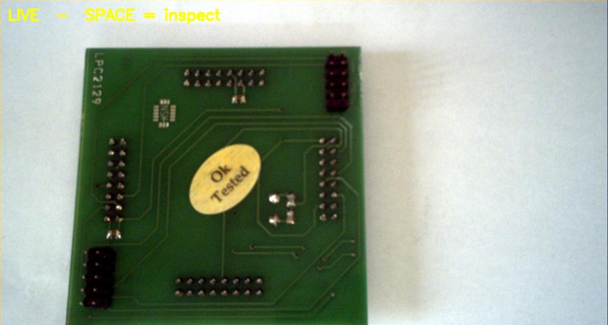
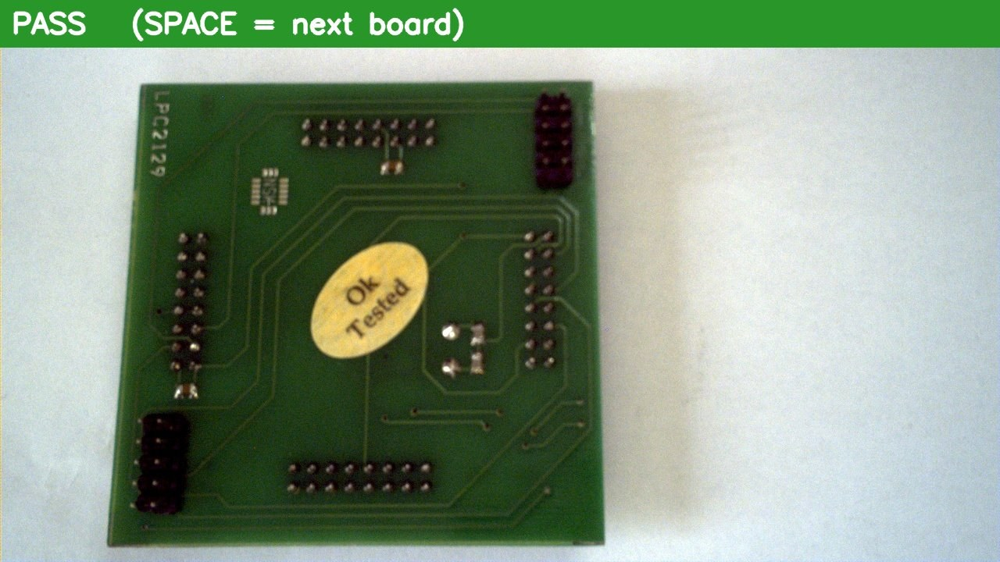
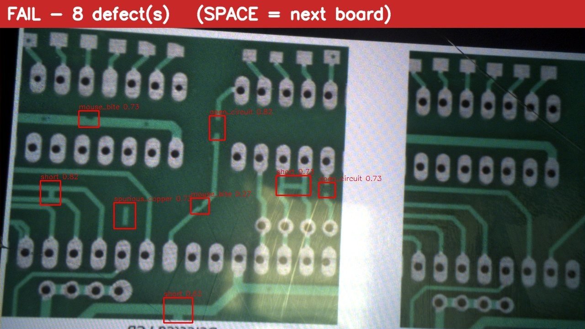
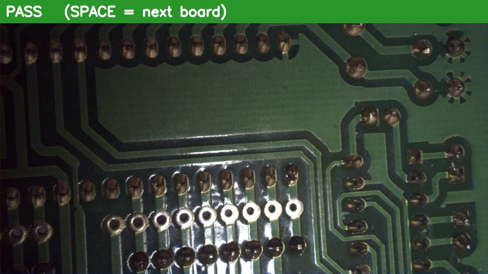
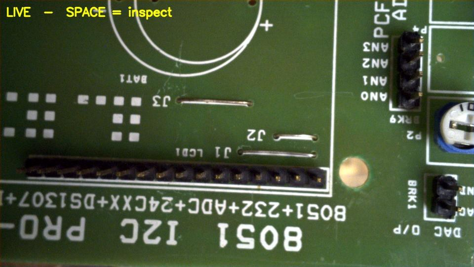
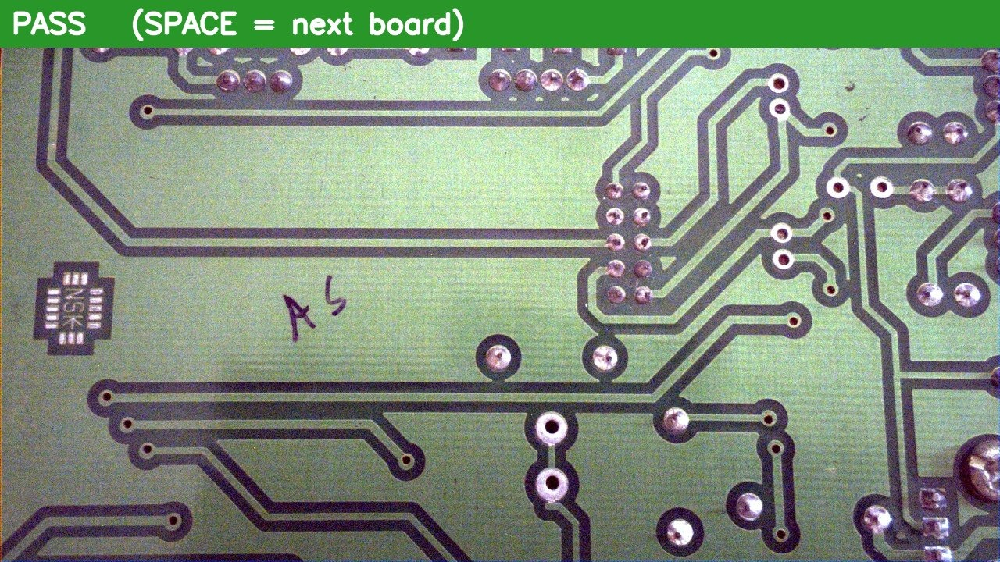

# Demo

Video: VIDEO_LINK_HERE

What the video shows:

1. The KV260 with the Pi Camera v2, connected to a laptop by one Ethernet cable, no internet.
2. The live view at http://192.168.50.1:8080.
3. A board under the camera, SPACE, and the result with boxes, severity, advice and PASS or FAIL.
4. The next board.

Screenshots from the station:

| Live view | Good board | Defect sheet |
| --- | --- | --- |
|  |  |  |
| **8051 board** | **Live view, 8051** | **Control board** |
|  |  |  |
