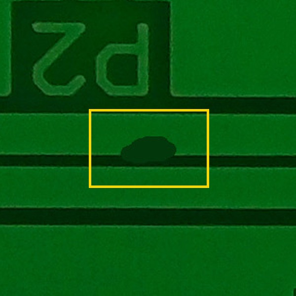
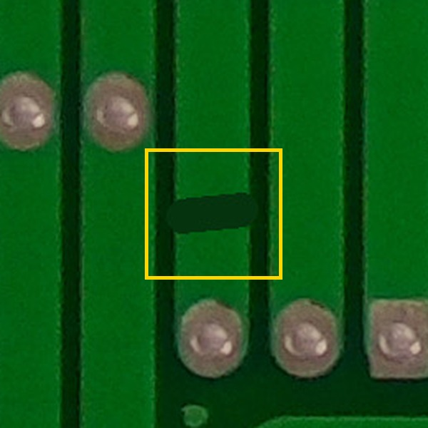
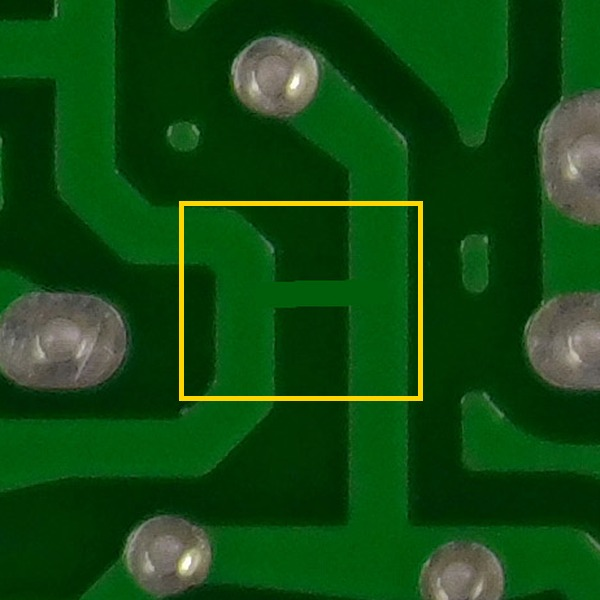
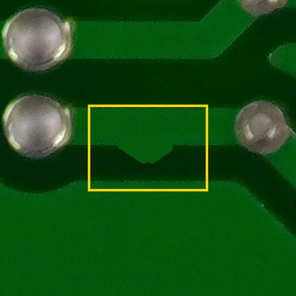
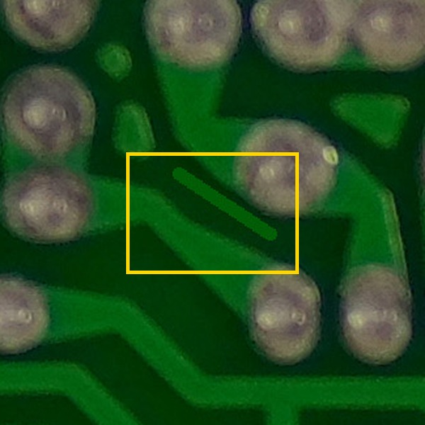
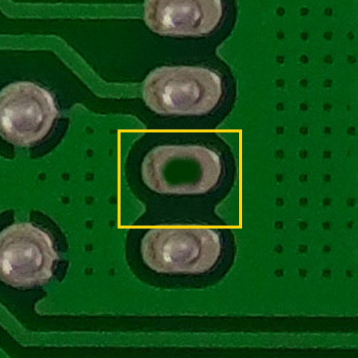

# Dataset

We use the augmented YOLO-format release of the PKU-Market-PCB defect dataset (Open Lab on Human Robot Interaction, Peking University). The data is not stored in this repository.

| Source | Link |
| --- | --- |
| PKU-Market-PCB, original (1,386 images, 6 defect types) | https://robotics.pkusz.edu.cn/resources/datasetENG |
| Augmented PCB Defect, YOLO format (10,668 images, 21,664 boxes) | https://datasetninja.com/augmented-pcb-defect |
| Kaggle mirror of the original images and XML labels | https://www.kaggle.com/datasets/akhatova/pcb-defects |

Reference: W. Huang and P. Wei, "A PCB dataset for defects detection and classification," arXiv:1901.08204, 2019.

## Split used

| Split | Images | Use |
| --- | --- | --- |
| train | 8,534 | training, INT8 calibration (500 random images) |
| val | 1,066 (2,164 defects) | model selection, FP32 and INT8 accuracy |
| test | 1,068 | held out, final check only |

| Class id | Class | Validation defects |
| --- | --- | --- |
| 0 | mouse_bite | 372 |
| 1 | spur | 369 |
| 2 | missing_hole | 331 |
| 3 | short | 411 |
| 4 | open_circuit | 359 |
| 5 | spurious_copper | 322 |

Labels are one line per defect: `class cx cy w h`, normalised to the image size. Images are letterboxed to 640 x 640 for training and on the board.

## Cleaning before training

`training/dataset_prep.py` does all three:

1. Six named classes instead of one merged class.
2. Ultralytics `.cache` files deleted before every run.
3. Label files named `*_256.txt` for `*_600.jpg` images renamed. This raised the counted validation defects from 1,595 to 2,164.

## Samples (`samples/`)

| mouse_bite | open_circuit | short |
| --- | --- | --- |
|  |  |  |
| **spur** | **spurious_copper** | **missing_hole** |
|  |  |  |

Crops are enlarged about 5 times; the yellow box marks the defect. `validation_batch_labels.jpg` is a batch of 16 validation images with their ground-truth boxes.
