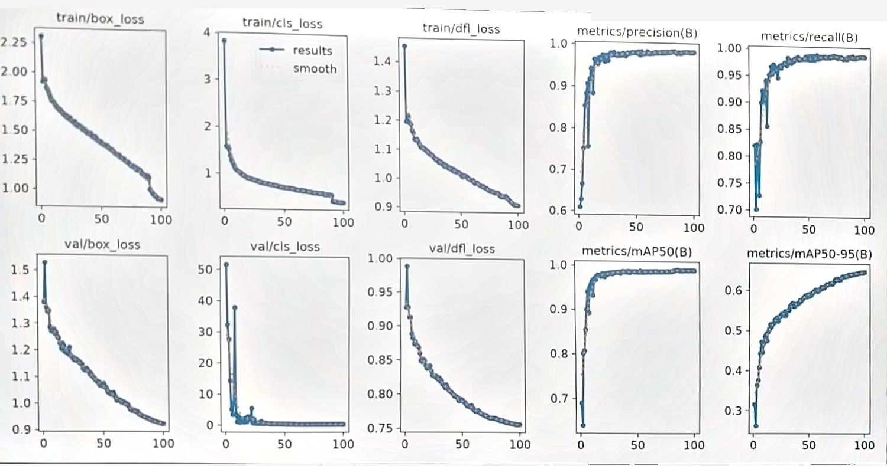
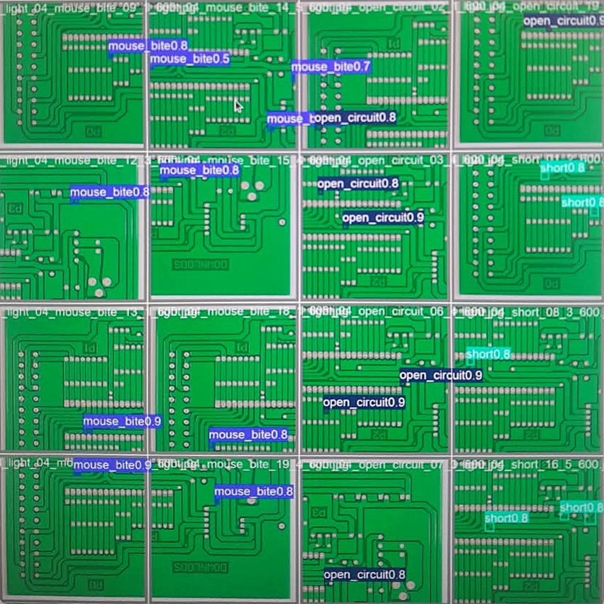
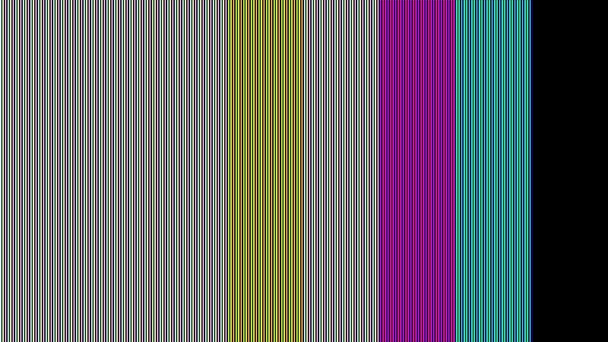
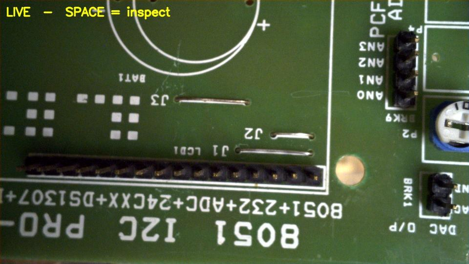

# Results

## Accuracy (validation split, 1,066 images, 2,164 defects)

| Class | Defects | FP32 mAP50 | FP32 mAP50-95 | INT8 mAP50 | INT8 mAP50-95 |
| --- | --- | --- | --- | --- | --- |
| mouse_bite | 372 | 0.995 | 0.776 | 0.993 | 0.766 |
| spur | 369 | 0.995 | 0.754 | 0.994 | 0.748 |
| missing_hole | 331 | 0.995 | 0.757 | 0.994 | 0.726 |
| short | 411 | 0.981 | 0.724 | 0.978 | 0.706 |
| open_circuit | 359 | 0.994 | 0.723 | 0.992 | 0.717 |
| spurious_copper | 322 | 0.994 | 0.754 | 0.994 | 0.743 |
| all | 2,164 | 0.992 | 0.748 | 0.991 | 0.734 |

FP32 precision 0.988, recall 0.992. Held-out test split (1,068 images, SiLU model): mAP50 0.993.

## Activation swap

| Model | mAP50 | Runs on DPU |
| --- | --- | --- |
| SiLU (original) | 0.992 | No, about 56 CPU/DPU splits |
| ReLU, no retraining | about 0.825 | Yes |
| Hardswish, fine-tuned | 0.992 (FP32) | No, compiler crash |
| LeakyReLU 26/256, fine-tuned | 0.992 FP32 / 0.991 INT8 | Yes, one subgraph |

## Speed on the KV260

| Stage | First version | Now |
| --- | --- | --- |
| Pre-processing (CPU) | about 30 ms | lookup table |
| DPU | about 33 ms | about 33 ms |
| Post-processing (CPU) | about 69 ms | decode only cells above threshold |
| Total | about 132 ms, 7.5 FPS | 46.3 ms, 21.6 FPS |

Camera station: about 15 s per board, almost all of it switching the FPGA between the camera design and the DPU design.

## Images

| Folder | Contents |
| --- | --- |
| `accuracy/` | Training curves (100 epochs), validation ground truth and model predictions |
| `kv260_board/` | DPU output on a validation image: five missing holes found, no false flags on normal pads |
| `camera/` | Sensor test pattern, striped frame before the HP0 fix, clean frame after it, first room frame, invalid output from the camera design's B3136 DPU |
| `real_boards/` | Live station results with the Pi Camera v2: good boards (PASS), printed defect sheet (FAIL, 8 defects) |
| `real_board_tests/` | A photo of one of our boards with an open circuit, a short and a missing hole added digitally, for testing on boards outside the dataset |
| `history/` | Early runs: the single-class first attempt and the first PC predictions |

| Training curves | Validation predictions |
| --- | --- |
|  |  |

| Before HP0 fix | After HP0 fix |
| --- | --- |
|  |  |
